# CP2 — RV32IM 實作（THRESHOLD）

## 1. 本次目標

只用 RV32IM 標準指令（不使用自訂指令）實作 THRESHOLD：把 `rs1`、`rs2` 視為 32 位元有號整數，`rs1 >= rs2` 回傳 255，否則回傳 0（`rs2` 為門檻）。在 Ripes 上驗證結果，並統計靜態指令數、動態指令數與分支數。本組只交一個版本：簡嘉佑撰寫的 `threshold_branch.s`。

## 2. 設計內容

### 程式碼
位於 `instructions/06_THRESHOLD/rv32im/threshold_branch.s`（作者：簡嘉佑）：

```asm
threshold:
    bge  a0, a1, ge_case
    li   a0, 0
    ret
ge_case:
    li   a0, 255
    ret
```

- `bge a0, a1, ge_case`：有號比較，`a0 >= a1` 成立就跳到 `ge_case`。
- 不成立：`li a0, 0` 後返回；成立：`li a0, 255` 後返回。

### 暫存器約定
- `a0`：輸入 `rs1`，執行完後放結果。
- `a1`：輸入 `rs2`（門檻）。
- `ra`（x1）：返回位址，由 `ret` 使用。

### 工具與設定
- Ripes v2.3.0，Single-cycle processor，ISA 為 RV32IM（已取消 C 壓縮擴充）。

### 環境建置
- **安裝 Ripes：** 到 Ripes 的 GitHub Releases 下載 Windows 版，解壓縮後執行 `Ripes.exe`。
- **選擇處理器：** 在 Processor 選單選 Single-cycle processor。
- **設定 ISA：** 選 RV32IM（RV32I 基本整數指令 + M 乘除法擴充），並取消 C 壓縮擴充，確保指令集與作業規範一致。
- 測試程式 `instructions/06_THRESHOLD/rv32im/ripes_test_branch.s`（林煉棠）：由測試用 `main` 設定 `a0`、`a1` 後以 `jal` 呼叫 `threshold`。

### 計數規則
- **範圍：** `threshold:` 到 `ret`（含 `ret`），不含測試用 `main` 與呼叫它的 `jal`。
- **以反組譯的真實指令計：** `ret` = `jalr x0 x1 0`，算 1 條；`li a0, 255` = 1 條 `addi`（`li a0, 0` 同理）。
- **分支數：** 只算條件分支（`bge`）；`jalr` 算跳躍，另外列出。
- **動態指令數：** 每組輸入各記一次。

### 靜態指令數與分支數

| 項目 | 數量 | 說明 |
|---|---:|---|
| 靜態指令數 | 5 | `bge`、`addi`、`jalr`、`addi`、`jalr` |
| 條件分支 | 1 | `bge` |
| 跳躍（`jalr`） | 2 | 兩個 `ret` |

## 3. 結果與分析

在 Ripes 實際執行 5 組測資（含 2 組邊界值），**5 組結果全部正確（5/5）**，threshold 的動態指令數每組都是 3。數據來源：`instructions/06_THRESHOLD/rv32im/count_result.md`（林煉棠）。

| # | 類型 | rs1 | rs2 | 預期輸出 | 實際輸出 | `bge` | threshold 動態指令數 | Ripes 總 retired | 結果 |
|---|---|---:|---:|---:|---:|:-:|---:|---:|:-:|
| 1 | 官方：相等 | 5 | 5 | 255 | 255 | 成立 | 3 | 8 | ✅ |
| 2 | 官方：差 1 | 4 | 5 | 0 | 0 | 不成立 | 3 | 8 | ✅ |
| 3 | 官方：負對 0 | -1 | 0 | 0 | 0 | 不成立 | 3 | 8 | ✅ |
| 4 | 邊界：最大對最小 | 2147483647 | -2147483648 | 255 | 255 | 成立 | 3 | 9 | ✅ |
| 5 | 邊界：最小對最大 | -2147483648 | 2147483647 | 0 | 0 | 不成立 | 3 | 9 | ✅ |

- 每組執行的 `bge` 都是 1 條。
- Ripes 總 retired 前三組 8 條、後兩組 9 條，差別在 `main`：`li` 放大數字時會展開成 `lui + addi`（`-2147483648` 只需 `lui`）。扣掉 `main` 的 5 或 6 條，threshold 都是 3 條。

### 各組員實際執行結果

以下由各組員**在自己的電腦**用 Ripes v2.3.0（Single-cycle、RV32IM）執行。

#### 林煉棠
- 執行日期：2026/10/22（2026/10/21 安裝 Ripes v2.3.0 並做小測試）
- 測資：上表 5 組（含 2 組邊界值）
- 結果：255、0、0、255、0
- 截圖：


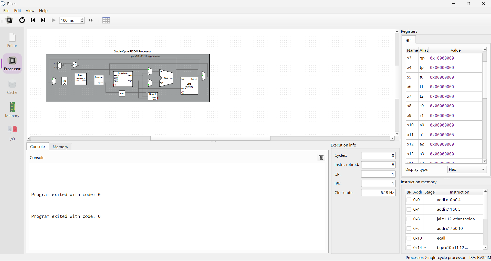
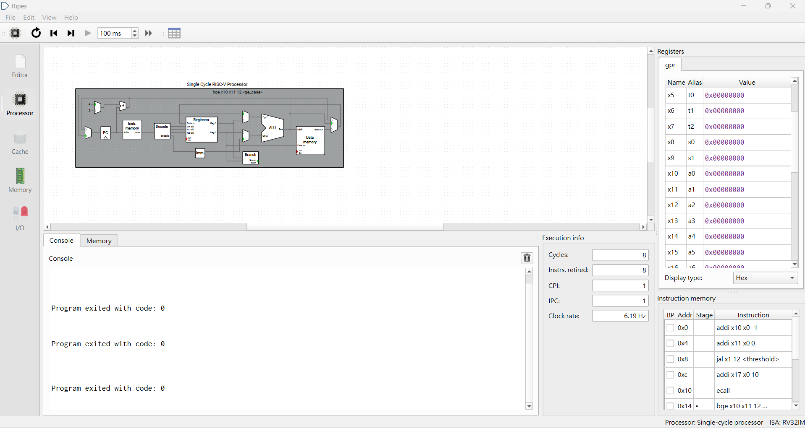
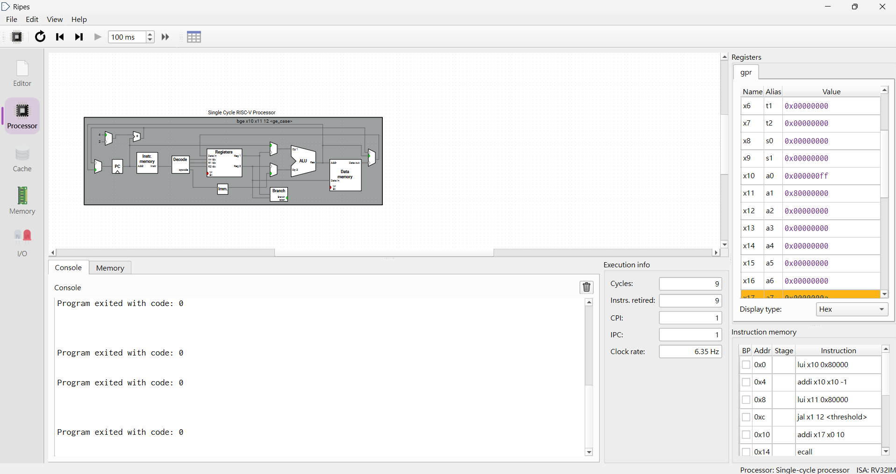
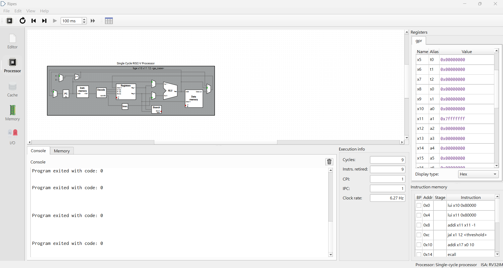

#### 簡嘉佑
- 執行日期：2026/10/22
- 測資：(5, 5)、(4, 5)、(-1, 0)
- 結果：255、0、0
- 截圖：

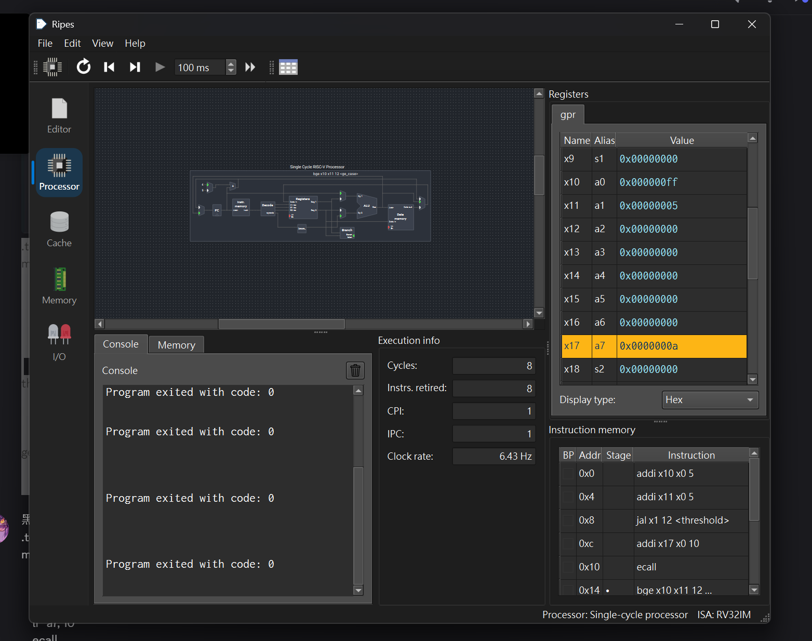
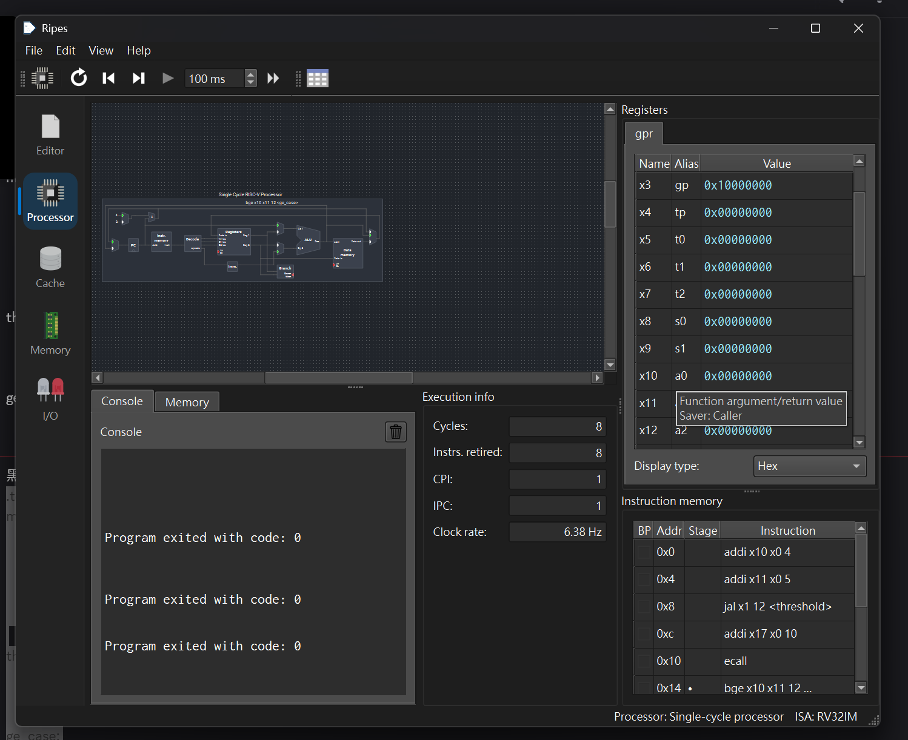
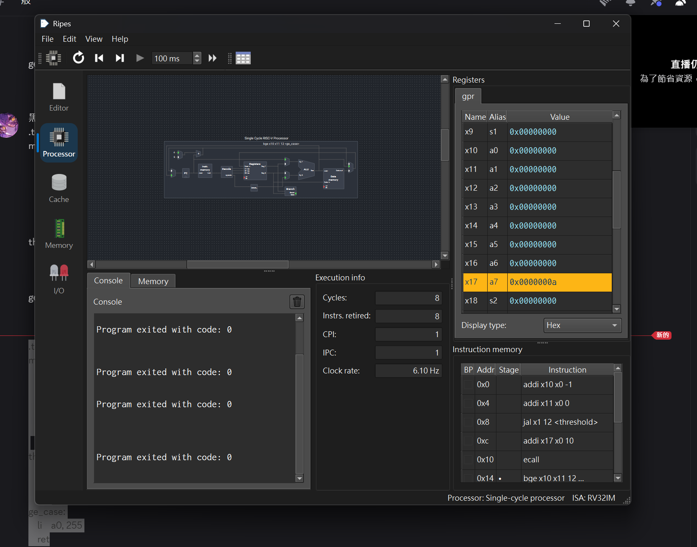

#### 羅允辰
- 執行日期：2026/10/22
- 測資：(5, 5)、(4, 5)、(-1, 0)
- 結果：255、0、0
- 截圖：

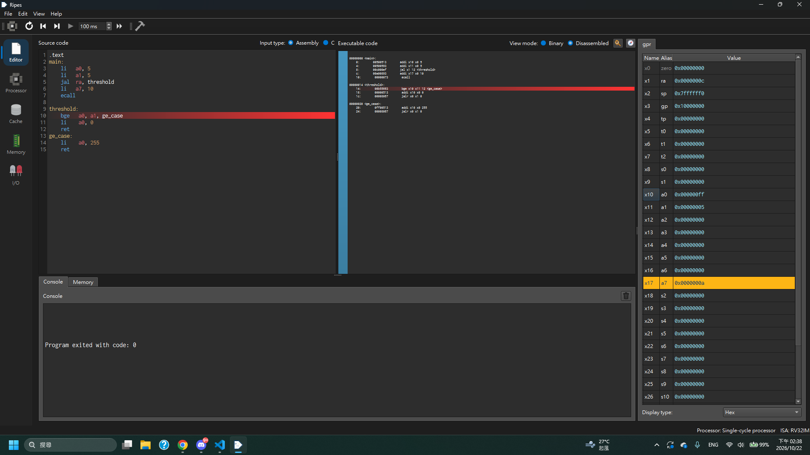
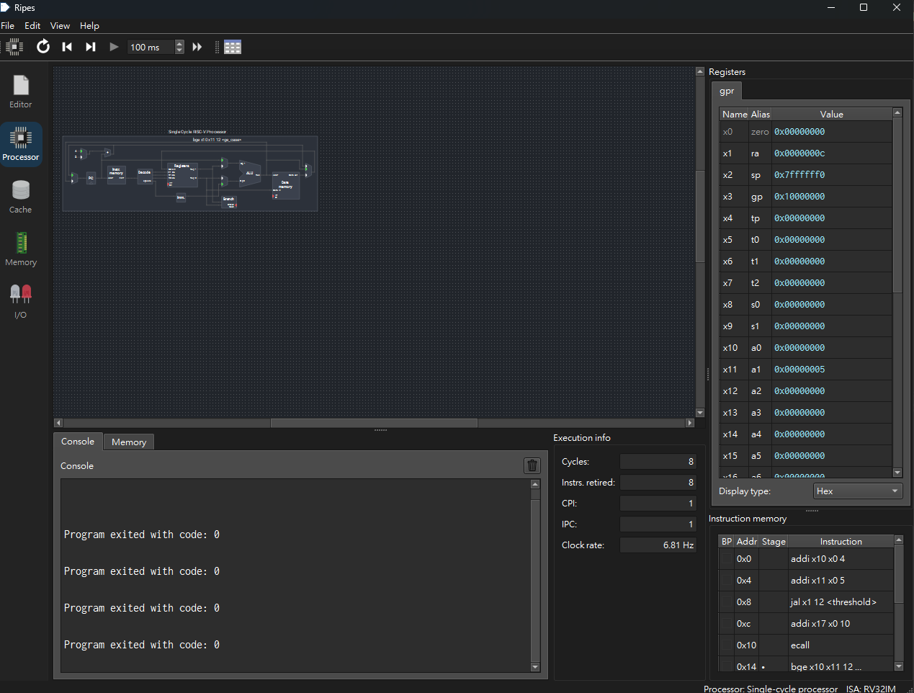
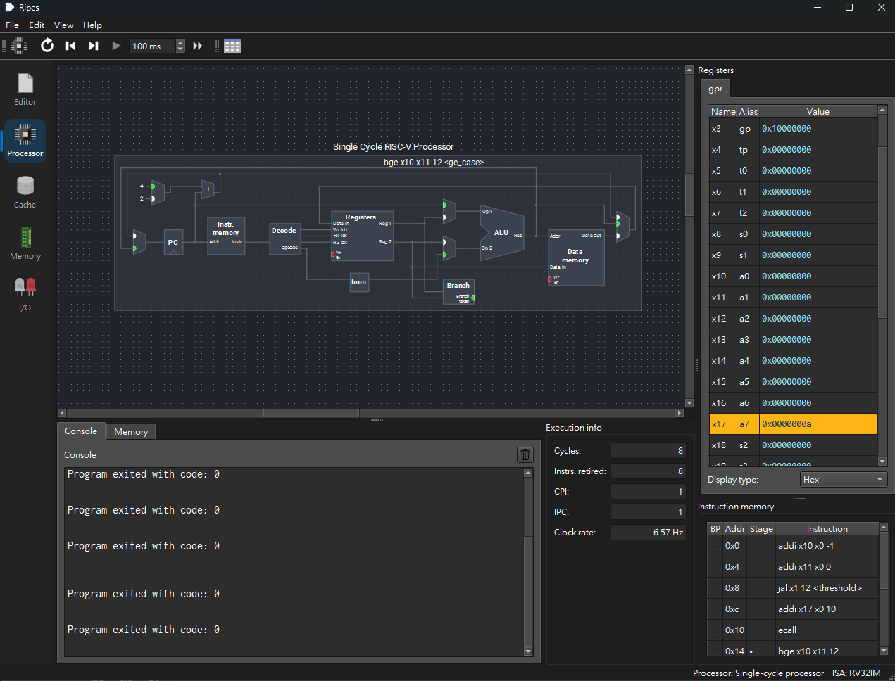

### 為什麼動態指令數不隨輸入改變
兩條路徑長度相同，且沒有迴圈：
- 成立：`bge`（跳走）→ `li a0, 255` → `ret`，共 3 條。
- 不成立：`bge`（不跳）→ `li a0, 0` → `ret`，共 3 條。

輸入數值只會影響 `main` 裡 `li` 展開的條數，不影響 threshold 本身。

### 為什麼用 `bge` 不用 `bgeu`
規格要求有號比較。`bge` 把暫存器當成二補數有號整數比較；`bgeu` 則把同一組位元當成無號數比較。以 (-1, 0) 為例：`-1` 的位元是 `0xFFFFFFFF`，無號下是 `4294967295`，所以 `bgeu` 會判斷「`4294967295 >= 0`」成立而跳到 `ge_case`，得到 **255**，與規格的 0 不符。

### 改成無號比較的影響
把 `bge` 換成 `bgeu`，其餘不變，用同樣 5 組測資執行：

| (rs1, rs2) | 預期 | `bge`（正式實作） | `bgeu`（實驗版） | `bgeu` 驗證方式 |
|---|---:|---:|---:|---|
| (5, 5) | 255 | 255 | 255 | Ripes 命令列模式驗證（Claude Code 代跑） |
| (4, 5) | 0 | 0 | 0 | Ripes 命令列模式驗證（Claude Code 代跑） |
| (-1, 0) | 0 | 0 | **255 ❌** | 林煉棠在 Ripes GUI 實際執行 |
| (2147483647, -2147483648) | 255 | 255 | **0 ❌** | 林煉棠在 Ripes GUI 實際執行 |
| (-2147483648, 2147483647) | 0 | 0 | **255 ❌** | 林煉棠在 Ripes GUI 實際執行 |

林煉棠在 Ripes GUI 手動把 `bge` 換成 `bgeu` 執行的截圖：

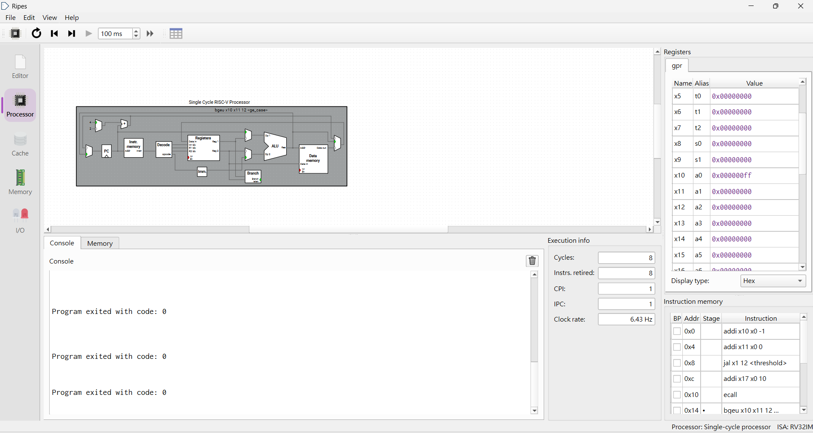

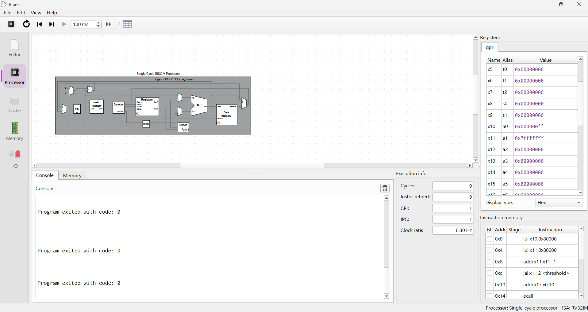

錯誤原因：
- (-1, 0)：`-1` 被無號比較當成 `0xFFFFFFFF`，比 0 大，所以得到 255。
- (2147483647, -2147483648)：無號下 `0x7FFFFFFF` 小於 `0x80000000`，所以得到 0。
- (-2147483648, 2147483647)：無號下 `0x80000000` 大於 `0x7FFFFFFF`，所以得到 255。
- (5, 5)、(4, 5) 兩個數都是非負數，有號與無號結果相同；只要有一邊是負數（最高位元為 1），結果就可能相反。
- 指令數不變：`bgeu` 也是 1 條條件分支，靜態仍為 5 條、動態仍為 3 條，只是結果不符合規格。

## 4. 遭遇的問題與解法

### 問題一：測試時改到 threshold 裡的數字（簡嘉佑）
- **問題：** 測 (4, 5) 時，把 threshold 裡的 `li a0, 0` 誤改成 `li a0, 4`。條件不成立（4 < 5）時，`a0` 傳回 4，而不是預期的 0。
- **原因：** 換測資時應該只改 `main` 前兩行載入輸入的 `li`，卻把 `threshold` 函式裡的常數也一起改掉。
- **發現：** 把程式碼貼到 Discord 後，林煉棠與 Claude Code 檢查程式時發現。
- **解法：** 改回 `li a0, 0` 後重新執行，`a0 = 0`，正確。
- **學到：** 測試輸入與函式實作要分開：換測資時只改輸入（`main` 裡的 `li`），不要動被測函式 `threshold` 的內容。

### 問題二：`git push` 顯示 `Everything up-to-date`（簡嘉佑）
- **問題：** 新增檔案後執行 `git push`，顯示 `Everything up-to-date`，沒有推送任何東西。
- **原因：** 檔案還沒 `git add`、`git commit`，倉庫裡沒有新的 commit 可以推送。
- **解法：** 依序執行 `git add <指定檔案>`、`git commit -m "..."`、`git push`，成功推送。
- **學到：** 只 add 指定的檔案；`test_threshold.exe` 是編譯產生的執行檔，不應加進 Git。

### 問題三：差點把 main 合併到別人的分支（羅允辰）
- **問題：** 要把最新的 main 抓下來時，貼上的指令中有 `git switch dev/1114405015`（簡嘉佑的分支），而不是自己的 `dev/1114405033`。
- **發現：** 執行前 Claude Code 先用 `git status`、`git branch -vv` 檢查，發現指令裡的分支不是自己的，停下來確認。
- **解法：** 留在自己的分支 `dev/1114405033` 執行 `git merge origin/main`，結果為 fast-forward，只新增 CP1.md。
- **學到：** 複製別人的指令前，要先確認分支名稱是不是自己的，並用 `git status` 確認目前在哪個分支。

## 5. 白話說明

THRESHOLD 像一個門檻檢查器：數字大於或等於門檻就輸出 255，比門檻小就輸出 0。這次不能用新指令，只能用 RISC-V 原本就有的指令拼出來：先比大小，夠就跳去放 255，不夠就放 0，然後返回。不管哪種情況都只執行 3 條指令。比較時要用有號的 `bge`，否則 -1 會被當成很大的數，誤判成 255。

## 6. AI 使用說明

- **林煉棠：** 使用 Claude（Claude Code）。用途：
  1. 解釋 Ripes 設定（處理器選 Single-cycle、ISA 取消 C、計數方式）。
  2. 協助寫測試用 `main`（`ripes_test_branch.s`）與 `count_result.md` 的表格和說明。
  3. 在林煉棠的電腦以 Ripes 命令列模式預先批次跑 5 組測資（預先檢查，不是本人手動執行），並用同樣方式跑 `bgeu` 對照實驗的 5 組。
  4. 整理給組員的 DC 訊息、整理截圖到 `figures/學號/` 資料夾，協助開 PR #4（代簡嘉佑開）與 #5。
  5. 提供給簡嘉佑的組合語言骨架與提示：骨架只留兩個數字讓他填，`threshold` 本身是簡嘉佑自己寫的，不是 AI 代寫。

  **由本組修改的內容：** AI 預估兩組邊界值的 Ripes 總 retired 是 10，實際在 GUI 跑出來是 9（`-2147483648` 的 `li` 只需 1 條 `lui`），依實測改成 9；`count_result.md` 原本把命令列預先批次寫成本人手動執行，已更正為 Claude Code 代跑；所有數字以 Ripes GUI 手動執行的截圖為準。

  **本人自己做的：** 安裝 Ripes，在 GUI 手動執行 5 組有號測資與 3 組 `bgeu` 錯誤案例並截圖，確認結果。
- **羅允辰：** 使用 Claude（Claude Code，Claude 桌面版）。用途：依本人提供的資料（程式碼、計數規則、執行結果、截圖檔名）整理本報告初稿，照 CP1 格式調整，加入截圖連結；並協助 Git 操作（`git fetch`、把 `origin/main` 合併到 `dev/1114405033`）。報告內容的取捨由本人決定；Ripes 的 3 組測資 (5,5)、(4,5)、(-1,0) 由本人在自己的電腦實際執行。
- **簡嘉佑：** 使用 Gemini。用途：協助確認程式邏輯、討論除錯問題。林煉棠提供的組合語言骨架與提示由 Claude Code 產生，骨架只留兩個數字讓本人填；`threshold_branch.s` 由本人撰寫完成，測資對照與 Ripes 驗證由本人在自己的電腦實際操作與比對。
- **許育維（組長）：** 使用 ChatGPT。
