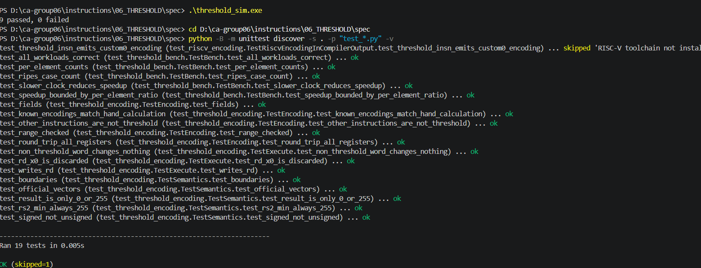
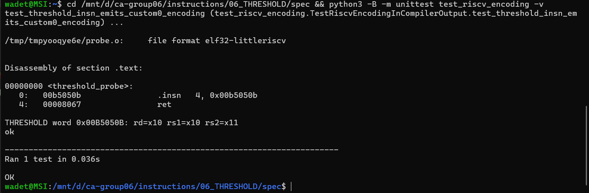
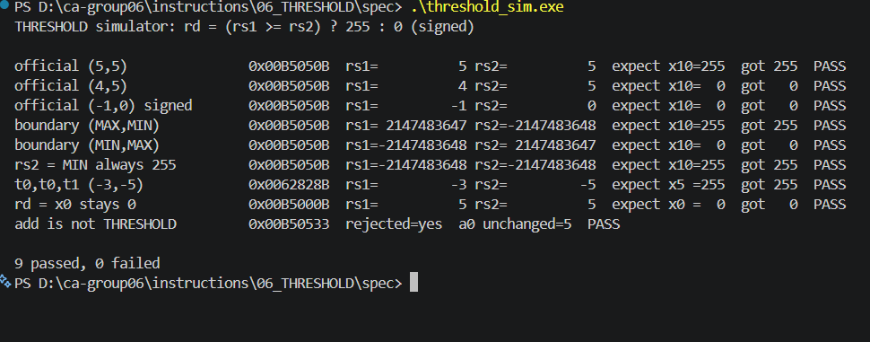
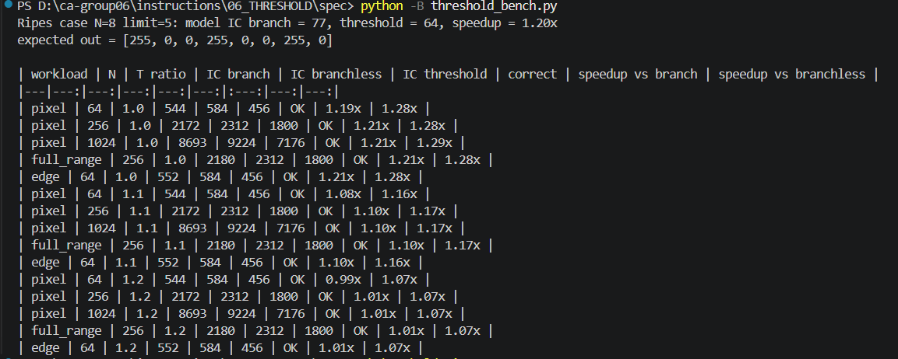
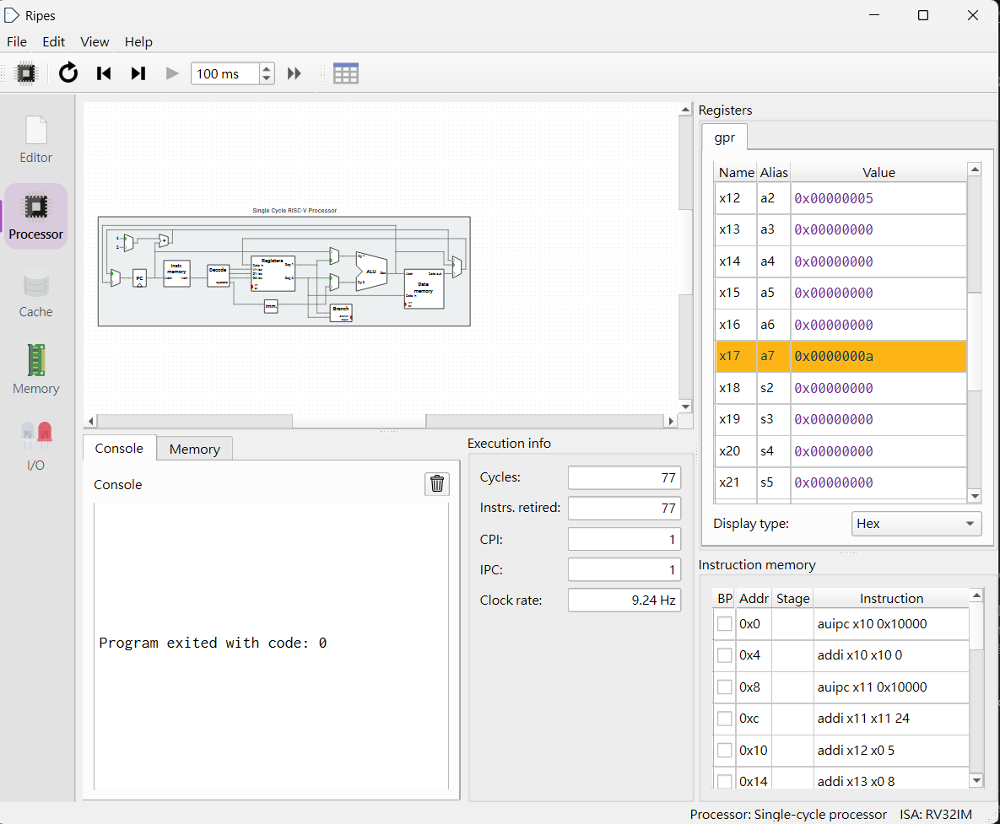
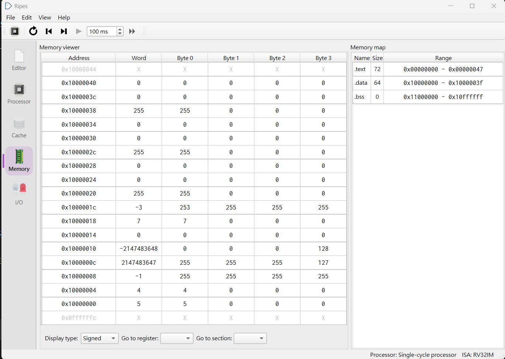

# CP3 — 指令規格與編碼

## 1. 本次目標

為 THRESHOLD 寫出正式的語意規格與虛擬碼，定義 R-type custom-0 的欄位與機器碼，並和 CP2 的 RV32IM 版本比較指令數。另外依助教要求，照老師 `mac_demo` 的做法實際執行編碼測試、RISC-V gcc 組譯檢查與指令數模型。

## 2. 設計內容

(語意規格、虛擬碼、3 個範例含 1 個邊界值、機器碼與欄位說明、指令數比較表;標明靜態或動態計數)

完整內容在 [`spec/README.md`](../spec/README.md)（A 段羅允辰、B／C 段簡嘉佑、D 段實作驗證）。以下為摘要。

### 2.1 語意規格（羅允辰）

依 HOMEWORK 第 6.7 節格式：

- **語意：** `rd = (rs1 ≥ rs2) ? 255 : 0`，**有號比較**；`rs1` 為輸入，`rs2` 為門檻。
- **運算元與定義域：** `rs1`、`rs2` 皆為 32 位元有號二補數，範圍 −2147483648（`0x80000000`）～ 2147483647（`0x7FFFFFFF`），任何值都合法。
- **結果範圍：** 只有 0 或 255（`0x000000FF`），高 24 位元永遠是 0。
- **邊界條件與溢位：** 只比較不做加減，不會溢位；`rs1 == rs2` 得 255；`rs2` 為最小值時一定是 255；`rd` 為 `x0` 時寫入被丟掉；若誤用無號比較，(−1, 0) 等 3 組會錯（CP1 `signed_vs_unsigned.c`、CP2 `bgeu` 對照）。
- **RV32IM baseline：** `rv32im/threshold_branch.s`（簡嘉佑），靜態 5、動態 3、條件分支 1（Ripes v2.3.0）。

### 2.2 虛擬碼（羅允辰）

```text
輸入:rs1(要判斷的值)、rs2(門檻),都當成 32 位元有號整數
1. 用有號比較判斷 rs1 是否大於或等於 rs2
2. 若成立,結果 = 255
   否則,結果 = 0
3. 若 rd 是 x0,不寫入(x0 永遠是 0)
   否則,把結果寫入 rd
```

### 2.3 三個範例（含 1 個邊界值）（羅允辰）

| # | rs1 | rs2 | rd | 說明 |
|---|---:|---:|---:|---|
| 1 | 5 | 5 | 255 | 官方測資，相等時「≥」成立 |
| 2 | −1 | 0 | 0 | 官方測資，有號下 −1 < 0；誤用無號會變 255 |
| 3 | 2147483647 | −2147483648 | 255 | **邊界值**：最大值對最小值；誤用無號會變 0 |

### 2.4 機器碼與欄位說明（簡嘉佑）

```
31      25 24   20 19   15 14  12 11    7 6       0
+----------+-------+-------+------+-------+---------+
|  funct7  |  rs2  |  rs1  |funct3|  rd   | 0001011 |
+----------+-------+-------+------+-------+---------+
```

| 欄位 | 位元 | 值 | 說明 |
|---|---|---|---|
| `funct7` | [31:25] | `0000000` | 助教指定（10/27 於 Discord 公告） |
| `rs2` | [24:20] | 暫存器編號 | 門檻 |
| `rs1` | [19:15] | 暫存器編號 | 輸入 |
| `funct3` | [14:12] | `000` | 助教指定（10/27 於 Discord 公告） |
| `rd` | [11:7] | 暫存器編號 | 結果 0 或 255 |
| `opcode` | [6:0] | `0001011` | custom-0（0x0B），HOMEWORK 第四節 |

| 組合語言 | funct7 | rs2 | rs1 | funct3 | rd | opcode | 十六進位 |
|---|---|---|---|---|---|---|---|
| `threshold a0, a0, a1` | 0000000 | 01011 | 01010 | 000 | 01010 | 0001011 | `0x00B5050B` |
| `threshold t0, t0, t1` | 0000000 | 00110 | 00101 | 000 | 00101 | 0001011 | `0x0062828B` |

機器碼由簡嘉佑手算，並用 Ripes 組譯 `add a0, a0, a1`（`0x00B50533`）確認手算方法。之後以 RISC-V gcc 實際產生 `threshold a0, a0, a1`，反組譯得到 `00b5050b`，與手算一致（見 3.3）。

### 2.5 實作驗證（照老師 `mac_demo` 的做法）

助教要求每次作業都要實際執行，因此參考老師倉庫 `mac_demo/` 的結構，在 `spec/` 加上：

| 檔案 | 對照 `mac_demo` | 內容 |
|---|---|---|
| `threshold_encoding.py`、`test_threshold_encoding.py` | `mac_encoding.py`、`test_mac_encoding.py` | 編碼、解碼、golden model 與 13 項測試 |
| `threshold.h`、`riscv_probe.c`、`test_riscv_encoding.py` | `mac.h`、`riscv_probe.c`、`test_riscv_encoding.py` | 用 `.insn r 0x0b, 0, 0, rd, rs1, rs2` 讓 RISC-V gcc 產生指令，再反組譯檢查 |
| `threshold_bench.py`、`test_threshold_bench.py` | `benchmark/dotbench.py` | 二值化 N 個數字的指令數模型（CPI = 1） |
| `threshold_loop_rv32im.s` | — | RV32IM 迴圈版，在 Ripes 執行以驗證模型 |
| `threshold_sim.c` | — | C 版解碼與執行（9 組） |

## 3. 結果與分析

### 3.1 指令數比較表（簡嘉佑）

單次呼叫，計數範圍為 `threshold:` 到 `ret`（含 `ret`），不含測試用 `main`：

| 項目 | RV32IM baseline（`threshold_branch.s`） | 自訂指令 `threshold` |
|---|---|---|
| 計數方法 | 靜態＋動態；**Ripes v2.3.0**（Windows），Single-cycle（`RV32_SS`），RV32IM | 靜態＋動態；依規格推算，未在模擬器執行（一般 Ripes 不支援 custom-0） |
| 靜態指令數 | 5 | 2（`threshold`、`ret`） |
| 動態指令數（每次呼叫） | 3（5 組測資皆為 3） | 2 |
| 條件分支數 | 1（`bge`） | 0 |

### 3.2 迴圈工作負載（動態指令數，模型估計）

把 N 個數字依同一個門檻二值化，每個元素的動態指令數：RV32IM 分支版成立 8、不成立 9；無分支版（`slt`）9；THRESHOLD 7。每次執行另有固定開銷 8 條。

| 工作負載 | RV32IM 分支版 | THRESHOLD | 加速比（CPI = 1） |
|---|---:|---:|---:|
| N = 8，門檻 5（同 `threshold_loop_rv32im.s`） | 77 | 64 | 1.20× |
| N = 1024，像素值 0～255，門檻 128 | 8693 | 7176 | 1.21× |
| 同上，若時脈週期慢 20%（T 比 1.2） | 8693 | 7176 | 1.01× |

- RV32IM 分支版的 77 條由林煉棠在 Ripes v2.3.0（Single-cycle、RV32IM）GUI 實際執行確認（`Instrs. retired` = 77），與模型一致；輸出 `out` 在 Memory 分頁確認為 255, 0, 0, 255, 0, 0, 255, 0。
- THRESHOLD 那欄是模型推算：一般 Ripes 把 `.word 0x00B5050B` 放進程式執行後，`a0` 沒有變成 255，表示 Ripes 不會執行 custom-0。
- 本次不要求 cycle 數，表中沒有 cycle 數；T 比只是假設，用來說明加速比對時脈週期很敏感。

### 3.3 實際執行結果（林煉棠，2026/10/30）

| 執行 | 結果 | 截圖 |
|---|---|---|
| Python 測試（Windows） | 共 19 項：18 項通過，1 項跳過（RISC-V 組譯檢查改在 WSL 跑） |  |
| RISC-V gcc 組譯檢查（WSL Ubuntu，`gcc-riscv64-unknown-elf`） | 通過；`threshold_probe` 反組譯為 `00b5050b`、`ret`，解碼為 rd = x10、rs1 = x10、rs2 = x11 |  |
| `threshold_sim.exe` | 9 組全部 PASS（官方 3 組、邊界值、`rs2` 最小值、`t0,t0,t1`、`rd = x0`、`add` 不被誤認） |  |
| `threshold_bench.py` | 3.2 節的數字 |  |
| Ripes GUI 執行 `threshold_loop_rv32im.s`（v2.3.0、Single-cycle、RV32IM） | `Instrs. retired` = 77、Cycles = 77，與模型一致，程式正常結束 |  |
| 同上，執行後在 Memory 分頁檢查 `out`（`0x10000020`～`0x1000003c`） | 255, 0, 0, 255, 0, 0, 255, 0，全部正確 |  |

### 3.4 分析與假設

- **加速比只有約 1.2 倍。** RV32IM 本來每個元素只要 8～9 條，THRESHOLD 只把「比較＋放 0 或 255」的 2～3 條換成 1 條；`lw`、`sw`、指標與計數器的更新都還在。老師 `mac_demo` 的 MAC 指令對強基準也只有 1.14 倍，結論相同：一條指令取代的工作越少，加速越有限。
- **基準的選擇：** 用和 CP2 相同寫法的分支版當基準（較強，指令較少）。換成無分支版（`slt`）會是 1.28 倍。報告以較強的基準為主，不刻意選差的基準。
- **假設：** CPI = 1、時脈週期不變；自訂指令若讓時脈週期變長，加速比會變小，T 比 1.2 時約只剩 1.0 倍。
- **5 Whys（為什麼加速比只有 1.2 倍）：**
  1. 為什麼只有 1.2 倍？→ 每個元素只少了 1～2 條（8～9 條變 7 條）。（`threshold_bench.py` 計數）
  2. 為什麼只少 1～2 條？→ THRESHOLD 只取代「比較＋寫 0／255」，載入、存回、迴圈控制還是要 5 條。（迴圈本體逐條列在 `spec/README.md` D 段）
  3. 為什麼比較本身在 RV32IM 只要 2～3 條？→ RV32IM 有 `bge`、`slt` 可直接做有號比較。（CP2 `threshold_branch.s`）
  4. 為什麼不能一次處理更多數字讓加速變大？→ HOMEWORK 第六節的語意固定為一次處理一個 32 位元數，改語意須經教師同意。
  5. 為什麼報告不寫更大的數字？→ 數字要能重現：RV32IM 的 77 條在 Ripes 實際跑過，模型和實測一致；沒量過的不寫。

## 4. 遭遇的問題與解法

### 問題一：一般 Ripes 無法執行自訂指令（林煉棠）
- **問題：** 助教要求自訂指令要實際執行，但 Ripes v2.3.0 不認得 custom-0。
- **發現：** Claude Code 在林煉棠的電腦以 Ripes 命令列模式，把 `.word 0x00B5050B` 放進程式、`a0 = a1 = 5` 執行，結束後 `a0` 仍是 5（應為 255）。
- **解法：** 改照老師倉庫 `mac_demo` 的做法：用 Python golden model 與測試驗證編碼和語意、用 RISC-V gcc 的 `.insn` 產生指令並反組譯確認機器碼、用指令數模型估計加速比，並把 RV32IM 迴圈版拿到 Ripes 實際執行驗證模型。
- **學到：** 「實際跑過」要說清楚是什麼在跑：RV32IM 基準是 Ripes 跑的，THRESHOLD 的指令數是模型推算的，兩者在報告中要分開寫。

### 問題二：funct3／funct7 尚未分配（林煉棠、簡嘉佑）
- **問題：** HOMEWORK 第四節規定 funct3、funct7 由教師分配，CP3 開始時（10/23）老師倉庫還沒公布，機器碼無法定案。
- **解法：** 先用 `000`／`0000000` 並標「暫定」；10/27 助教在 Discord 公告都用 0，改標為「助教指定」，機器碼不用改。
- **學到：** 改 funct 只會改機器碼，不影響指令數；先把會變動的地方標清楚，之後只要改一處。

## 5. 白話說明(200 字以內)

THRESHOLD 像一個「過門檻就亮燈」的開關：數字大於或等於門檻輸出 255，否則輸出 0。原本要用好幾條指令拼出來，現在一條新指令就完成。機器碼就是給 CPU 的 32 格開關，最右 7 格告訴它「這是自訂指令」，其他格寫要讀哪兩個暫存器、結果放哪裡。原本以為新指令會快很多，實際算才發現每個數字只省 1、2 條，因為讀資料、存回去、數到第幾個這些工作還是要做，所以只快約 1.2 倍。

## 6. AI 使用說明

- **林煉棠：** 使用 Claude（Claude Code）。用途：
  1. 同步分支、閱讀 HOMEWORK，產生 `spec/README.md` 與本檔的範本與提示；整理待確認問題與分工、評估助教 4.77 加速比的可行性。
  2. 依林煉棠要求撰寫 `spec/` 的實作程式：`threshold_encoding.py`、`test_threshold_encoding.py`、`threshold.h`、`riscv_probe.c`、`test_riscv_encoding.py`、`threshold_bench.py`、`test_threshold_bench.py`、`threshold_loop_rv32im.s`、`threshold_sim.c`（結構參考老師 `mac_demo`）。
  3. 在林煉棠的電腦預先執行：Python 測試、C 模擬器、Ripes 命令列模式跑 `threshold_loop_rv32im.s`（77 條）與 `.word 0x00B5050B` 實驗；整理本報告初稿與 `spec/README.md` D 段、`CONTRIBUTIONS.md`。

  **本人做的：** 決定照老師 `mac_demo` 的做法；在 WSL 安裝 RISC-V gcc；在自己的電腦執行 Python 測試、RISC-V gcc 組譯檢查、`threshold_sim.exe`、`threshold_bench.py`，並在 Ripes GUI 執行 `threshold_loop_rv32im.s`，全部截圖（3.3 節）。

  **由本組修改的內容：** AI 原本只寫在終端機執行的 C 模擬器，本人要求改為照老師 `mac_demo` 的做法（編碼測試、RISC-V gcc 組譯檢查、指令數模型）；funct3／funct7 原標「暫定」，依助教 10/27 公告改為「助教指定」；Ripes 迴圈的 77 條與輸出原為 Claude Code 命令列預先執行，改以本人在 Ripes GUI 手動執行的截圖為準。程式碼本身未由本人修改。
- **羅允辰：** 使用 Claude(Claude Code)。用途:教學講解二補數範圍、溢位、x0、有號與無號比較等觀念,並協助撰寫 spec/README.md A 段(語意規格、虛擬碼、3 個測試向量)初稿;另協助合併 CP3 範本分支、commit、push 與確認 PR 開在組內 fork。本人修改:用自己的話改寫「無號比較會錯」「rd 為 x0」兩項,並新增「rs2 為最小值」的邊界條件;其中輸出值(255 / 0)原本寫反,經 Claude 指出後修正。
- **簡嘉佑：** CP3 使用 Claude Code(Claude 桌面版)。一開始 AI 直接代寫 B、C 段並推送(commit 8e97981),之後發現違反 HOMEWORK 第 7.2 節，已用 git revert 撤回(435a97f)。重做時 AI 只當助教：用不同的例子說明暫存器查法、二進位轉換、欄位順序與十六進位轉換，檢查我的計算並指出錯誤步驟，也提供了說明句的填空句型與選擇題。兩組機器碼(0x00B5050B、0x0062828B)和 C 段指令數是我自己算的，並在 Ripes 組譯 add a0, a0, a1 驗證方法;README 內容由我自己輸入並推送(commit b4862c6,PR #8)。
- **許育維（組長）：** 使用ChatGPT。用途：查詢GitHub 操作方式，包括建立與合併Pull Request、建立Tag、向老師倉庫提交PR；並協助整理PR 說明欄的文字，了解各步驟與注意事項。由本人修改或確認：依AI 提供的步驟，由本人完成分支確認、PR 建立與合併、Tag 建立與提交，並自行檢查合併結果、提交紀錄與檔案內容是否正確。 AI 只提供操作教學與文字整理，實際操作與最終確認皆由本人完成。
